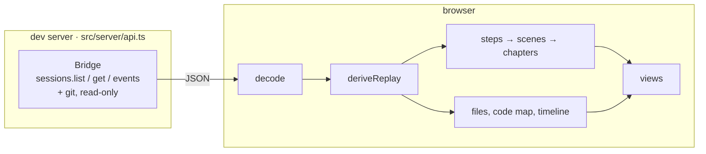

<div align="center">

# Replay

Follow a coding-agent session as a story: chapters, scenes, a code map and a timeline you can play.

[](package.json)
[](vite.config.ts)
[](package.json)
[](../../README.md)

</div>

## What is this?

Replay helps you review what a coding agent did. Pick a session, and it shows you what was asked,
what the agent explored, what it changed and which checks it ran, with each check's result. You can
read it as a briefing, play it back step by step, or look at every session on your machine at once.

It works with any harness [Bridge](../../README.md) reads, including Claude Code, Codex, OpenCode, pi,
Gemini CLI and Cursor, and shows them all the same way.

## Quick Start

```bash
pnpm install                                           # from the repo root
pnpm replay                                            # your local history → http://localhost:5173
pnpm --filter @agentbridge/example-replay dev:fixtures # sample sessions instead
```

Replay reads the agent history already on your machine. Run `pnpm bridge doctor` to see what it
found and where. Everything stays local unless you turn on [inferred check
results](#inferred-check-results-optional).

## The session list

Each row shows:

- **Title:** the session's own title, or else the first line of its first prompt.
- **Model:** the model that did most of the work, with its vendor's logo. Hover to see the other
  models it used.
- **Tokens:** input, cached input and output, summed over every model call. Hover for the
  breakdown. Sessions whose harness doesn't record usage show "—".

The first visit reads each session once and caches the summary in
`~/.bridge/replay-summaries.json`, so later visits load in under a second.

## Reviewing a session

Open a session and you land on the **overview**. It shows what was asked, the files that changed
most, the last result of every check the agent ran (failures first), and what the agent's closing
reply claimed. From there, read the chapters, press <kbd>Space</kbd> to play, or jump straight to
a chapter.

The first time you open a session, a short tour shows each part of the page and explains its marks.
Click **Tour** in the top bar to see it again.

### Reading the story

- **Chapters** group the work for one prompt into phases: exploration, implementation, validation
  or debugging. A chapter is called a fix only when the check that failed is run again and passes.
  A different check passing doesn't count.
- **Scenes** are the steps inside a chapter: a stretch of reading, a set of changes, a check run or
  a command. Labels say what happened, not what the agent meant to do: "Explored src/auth",
  "Changed session.ts and auth.ts", "Ran tests → failed".
- **Checks** are tests, type checks, lint and builds, recognised from the command
  (`pnpm test`, `cargo clippy`, `nix develop -c gleam test`). When a pipe or `|| true` hides the
  real exit status (`pnpm test | tail`), the result reads **unknown** and isn't treated as a pass.
- **Claims** marked ⚠ are statements in the agent's closing reply, such as "all tests pass", that
  the recorded checks don't support. This needs [inferred check
  results](#inferred-check-results-optional) to be on.
- **The code map** shows every file the session touched, grouped by directory and sized by how
  much happened to it. During playback it stays in place and only highlights the files involved.

### Views

| View | Shows |
|---|---|
| **Story** | Chapters and scenes, with evidence, diff and terminal panels |
| **Changes** | Every changed file and its diff; mark files as reviewed |
| **Events** | The raw event stream, for when you need the details |
| **Fleet** | This session and all its subagents, over time |

### Keyboard

| Keys | |
|---|---|
| <kbd>Space</kbd> | play / pause |
| <kbd>←</kbd> <kbd>→</kbd> | previous / next event |
| <kbd>Shift</kbd>+<kbd>←</kbd> <kbd>→</kbd> | previous / next scene |
| <kbd>K</kbd> <kbd>J</kbd> | previous / next chapter |
| <kbd>1</kbd> <kbd>2</kbd> <kbd>4</kbd> <kbd>8</kbd> | playback speed |
| <kbd>E</kbd> <kbd>D</kbd> <kbd>T</kbd> | evidence, diff, terminal |
| <kbd>F</kbd> | select the file under the cursor |
| <kbd>R</kbd> | mark the current scene reviewed (or the selected file in Changes) |
| <kbd>Esc</kbd> | clear the selection, go back to Story, pause |

### Review marks and links

Mark scenes and files as reviewed as you go. Marks are saved in this browser
(`localStorage`) and stay attached to the right scene even if the session keeps growing.

Every position has a link you can share or bookmark:

```text
#/session/<id>                   overview
#/session/<id>/story/ch2         a chapter
#/session/<id>/scene/sc4         a scene (keeps the selected file)
#/session/<id>/event/<eventId>   an event
#/session/<id>/file?path=…       a file
#/session/<id>/changes           Changes view
#/session/<id>/events            Events view
```

The browser's Back button undoes navigation. Playback updates the link without adding history
entries.

## Fleet

Open **Fleet** from the session list (`#/fleet`) to see every session on your machine as one
picture over time. Sessions appear when they start and glow while they work. Subagents hang off the
session that spawned them, and top-level sessions cluster around their project.

- **Left panel:** the date at the playhead, counts, and session types. Click a type to show only
  that type.
- **Right panel:** the spawn log. Select a session to see its tree and a link to its replay.
- **Activity strip:** click to move the playhead. <kbd>Space</kbd> plays at ×1 to ×20 days per
  second, and <kbd>←</kbd> <kbd>→</kbd> step one day at a time. Long idle stretches collapse to a
  dashed "⋯" break (hover for how long), and playback skips them.
- **One project:** `#/fleet?project=…` shows a single project and keeps whole spawn trees.

**A session's own fleet** (`#/fleet?session=…`, or **Fleet** in a session's top bar) shows one
session's family: the root session, every subagent below it, and each agent's steps orbiting it.
Steps are colored by kind (read, change, check, command, conversation), and failed checks are
ringed in red. Playback covers the whole family in two minutes at ×1, whether it ran for an hour or
for months. Opening it from a subagent shows the whole family from the root.

The layout is deterministic, so the same sessions always land in the same place.

## Inferred check results (optional)

Agents often pipe checks into `tail` or append `|| true`, which hides whether the check passed. The
output usually still shows the result ("408 passed, 1 failures", "error TS2345"). If you opt in,
Replay asks [Jev](https://docs.typesafe.ai), TypeSafe's judgment model, to read that output.

Create `examples/replay/.env.local` (git-ignored, never sent to the browser):

```bash
REPLAY_JEV=1
TYPESAFE_API_KEY=…
# REPLAY_JEV_MODEL=jev-1.13.0   # optional: pin a version instead of jev-latest
```

**What you get**

- Unknown check results are filled in and labelled **passed (inferred)** or **failed (inferred)**.
  The terminal shows the model and its confidence. Results below 0.6 confidence stay unknown.
- A recorded result is never overridden.
- Closing replies are checked against the recorded runs, and unsupported claims get a ⚠.
- Commands that look like checks but aren't recognised (custom scripts, make targets) can be
  identified as tests, type checks, lint or builds.
- The story shows straight away. Inferred results arrive a moment later.

**What is sent**

- For each hidden check: the command and the last 80 lines of its output, with Bridge's redaction
  applied on the server. The browser can't choose what is sent.
- For each request: the agent's closing reply.
- If other commands ran after the check in the same shell line, its output isn't the check's own,
  and nothing is sent for it.

Before you turn this on, think about what your sessions' output may contain. Without both
variables, nothing leaves your machine.

On 465 hand-labelled checks from real sessions, at the default threshold, Jev answered 88% of them,
agreed with the label on 99% of those, and never showed a failed check as passed.

<details>
<summary><b>Measure it on your own history</b></summary>

<br>

```bash
pnpm --filter @agentbridge/example-replay eval:jev collect   # → ~/.bridge/replay-jev-eval.jsonl, label: null
# set "label" to passed / failed / unclear on the lines you check
pnpm --filter @agentbridge/example-replay eval:jev run
```

`run` reports, per threshold, how many results would be shown, how many agree with your labels,
and how many failed checks would be shown as passed. The claims and command checks have their own
modes (`collect-…` / `run-…`).

</details>

## How it works



The dev server reads sessions through Bridge, read-only. The browser builds the story with
`deriveReplay(session, events)` (`src/replay/derive.ts`). That function needs no network and no
model, and only uses Bridge's canonical `Session` and `SessionEvent`. It never checks which harness
recorded a session, so every harness gets the same story.

## Development

```bash
pnpm check   # from the repo root: typecheck (including Replay) and all tests
```

| File | Covers |
|---|---|
| `test/replay.test.ts` | Nothing under `src/` may name a harness, `harness.id`, `source.provider` or a native tool |
| `test/derive.test.ts` | Story derivation on every harness's fixtures, structural invariants, check recognition |
| `test/ui-state.test.ts` | Navigation sync and malformed routes |
| `test/fleet.test.ts` | Fleet model and layout |
| `test/usage.test.ts` | Session usage, model vendors and labels, session titles |
| `test/jev.test.ts` | Inferred check results, claims and command recognition |

```text
examples/replay/
├── scripts/
│   └── eval-jev.ts         # measure inferred results against your labels
├── src/
│   ├── app/                # entry point, routes, API client, styles
│   ├── components/         # code map, diff viewer, evidence, terminal, timeline, tour
│   ├── fleet/              # fleet model, deterministic layout, Web Worker
│   ├── map/                # code-map layout and file relationships
│   ├── models/             # model name → vendor
│   ├── playback/           # timeline cursor, keyboard shortcuts
│   ├── replay/             # deriveReplay: steps, turns, files, usage, claims
│   ├── review/             # review marks
│   ├── server/             # dev-server API over Bridge, Jev client
│   ├── story/              # check recognition, chapter wording
│   ├── views/              # session list, session, story, changes, events, fleet
│   ├── index.ts
│   └── replay.ts
├── test/
├── AUDIT.md
├── GOAL.md
├── index.html
├── package.json
├── README.md
├── tsconfig.json
└── vite.config.ts
```

## Documentation

| Resource | Description |
|---|---|
| [GOAL.md](GOAL.md) | Product spec for Replay |
| [AUDIT.md](AUDIT.md) | UX and derivation audit |
| [Bridge README](../../README.md) | The library Replay is built on |
| [Bridge spec](../../docs/spec.md) | The canonical `Session` / `SessionEvent` model |
| [Architecture](../../docs/architecture.md) | How Bridge's packages fit together |
